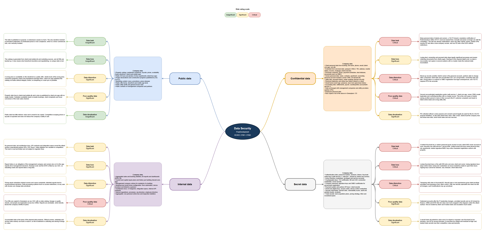

# Task 1. Data Security Checklist

Data classification and risk assessment for **PropDevelopment**, done according to ISO/IEC 27001 / 27002.

**Mind map:** [`data-security-mindmap.drawio`](data-security-mindmap.drawio). Open it in [draw.io / diagrams.net](https://app.diagrams.net) or in the draw.io VS Code extension.

The mind map has this structure: **Data Security → data category → company data → risk + rating → reasoning for the rating**.

Risk rating scale: **Insignificant**, **Significant**, **Critical**.

## Context from the system analysis

The ratings come from these findings in the system description and the C4 container diagram:

- There are several uncoordinated client registration points: `auth-service-1` (Keycloak), `client-crm-app` ("client registration") and the owner CRM. The same person exists in several databases and none of them is the master record.
- One Keycloak (`auth-service-1`) serves both clients and owners, while their profiles live in two different CRMs. This is the likely source of users seeing another client's name in their personal account.
- Raw CDC streams copy five operational databases, full of personal data, into Greenplum / S3 with no masking, data catalog or access restrictions. BI analysts and business analysts access the DWH directly.
- `tenant-core-app` calls partner (management company / utility provider) APIs and the payment system directly. There is no API gateway, no common security policy and no tenant isolation. Partner contracts expose personal data and allow cross-company access.
- The firewall only protects the external entry points. Internal service-to-service traffic is not controlled.
- One Active Directory is shared by finance, both CRMs and the DWH. There is a single security specialist, who does not see all changes.
- The online deal involves passport-level data and legally significant actions through SMEV, and the smart home controls the apartment door locks.

## Assumptions

The case does not list every data field, so some items in the classification are reasonable inferences rather than facts from the description:

- **Extended booking form:** passport details, SNILS, TIN, address, marital status, income and mortgage data are assumed, because the form feeds the online deal and state registration via SMEV, which require such data.
- **Smart home:** device event logs and smart lock digital keys/access codes are assumed to be stored or processed by PropDevelopment systems, because owners control the apartment lock from the app.
- **Finance:** payroll, settlements and counterparty data are assumed to be in `accountant-service-1` as a typical accounting system.
- **Secrets:** a company electronic signature and SMEV certificates are assumed for the SMEV integration; partner and payment API keys are assumed for the partner and payment integrations.
- **Trade secrets** (land acquisition, pricing strategy, M&A plans) are assumed as typical for a top-3 developer; they are not mentioned in the case.
- **Public data:** project declarations and construction progress are assumed to be published, because Russian law (214-FZ) requires it for shared-construction developers.

## Public data

_Intentionally published information; disclosure causes no harm._

**Company data in this category**

- Property catalog: residential complexes, layouts, prices, availability (Sales storefront, client-mart-estate-app)
- Public 3D tours and photos of show apartments (client-tour-app)
- Project declarations and construction progress (published by law, 214-FZ)
- Marketing content, news, promotions, press releases
- Public offer terms, storefront and mobile app texts
- Public utility tariffs and general house rules
- Public contacts of management companies and partners

| Risk | Rating | Why |
|---|---|---|
| Data leak | **Insignificant** | The data is published on purpose, so disclosure causes no harm. The only sensitive moment is premature publication of unreleased prices or new complexes, which is a minor commercial loss, not a security incident. |
| Data loss | **Insignificant** | The catalog is generated from client-mart-estate-db and marketing sources, and all DBs are backed up. A loss means short storefront downtime and republishing; no unique data is lost. |
| Data distortion | **Significant** | A wrong price or availability on the storefront is a public offer: clients book at the wrong price, consumer-protection claims and reputational damage follow. client-crm-app publishes the catalog via Kafka without integrity control, so tampering or a bad sync is possible. |
| Poor-quality data | **Significant** | Property data lives in client-mart-estate-db and is also re-published by client-crm-app with no single master. Outdated availability leads to double bookings, client complaints and lower conversion of the main sales channel. |
| Data devaluation | **Insignificant** | Public data has little intrinsic value and is meant to be copied. Competitors scraping prices or layouts is expected and does not reduce the company's ability to sell. |

## Internal data

_For employees and authorised users only; disclosure causes limited harm._

**Company data in this category**

- Aggregated sales and booking statistics, BI reports and dashboards (DWH, BI)
- Current and capital repair plans and history per building (tenant-core-app)
- Management company notices for residents of a building
- Building-level smart home configuration: floor automation, device inventory (not linked to a person)
- Architecture docs, C4 diagrams, integration specs, internal API contracts
- Internal regulations, processes, org structure, employee directory
- Aggregated, non-personal online tour and inspection statistics

| Risk | Rating | Why |
|---|---|---|
| Data leak | **Significant** | No personal data, but architecture docs, API contracts and integration specs reveal the attack surface (unprotected partner APIs, CDC flows). Sales statistics are valuable to competitors. The harm is real but limited and not subject to regulator fines. |
| Data loss | **Significant** | Repair history is an obligation of the management company and owners rely on it in the app; reports drive management decisions. Backups exist, but the DWH is filled by raw CDC, so rebuilding marts and reports takes a long time. |
| Data distortion | **Significant** | Wrong repair schedules mislead owners and cause complaints; distorted reports lead to wrong business decisions. Data processing systems have no access restrictions, so any user with access can change data unnoticed. |
| Poor-quality data | **Critical** | Five DBs are copied to Greenplum as raw CDC with no data catalog, lineage or quality checks, and people are duplicated across two CRMs. Reports are unreliable, which directly blocks the company's BI/ML/AI plans. |
| Data devaluation | **Significant** | Accumulated data is the basis of the planned data products. Without owners, metadata and access rules nobody can trust or reuse it, so the investment in collecting and storing it brings no value. |

## Confidential data

_Personal, financial and contractual data protected by law and contracts; disclosure causes serious harm._

**Company data in this category**

- Client personal data from booking: full name, phone, email (client-crm-app, crm-db)
- Extended form and deal data: passport, SNILS, TIN, address, marital status, income, mortgage (client-mart-db)
- Purchase contracts, prices, payment schedules, deal statuses, documents sent via SMEV
- Owner personal data: name, contacts, apartment, ownership, personal account numbers (owner CRM, crm-tenant-db)
- Utility bills, payment history, meter readings (tenant-core-db)
- Personal inspection and online tour history linked to a client
- Smart home event logs: presence, door lock open/close history
- Accounting data: settlements, payroll, counterparties (accountant-service-1)
- Data exchanged with management companies and utility providers (partner APIs)
- Employee personal data
- Raw copies of all of the above in Greenplum / S3

| Risk | Rating | Why |
|---|---|---|
| Data leak | **Critical** | Mass personal data of clients and owners: a 152-FZ breach, mandatory notification of Roskomnadzor within 24/72 h, turnover-based fines, lawsuits and press coverage (as with the competitor). The risk has already materialised: users see other clients' names, partner APIs expose PD and allow cross-company access, and raw PD sits in the DWH without restrictions. |
| Data loss | **Significant** | Losing deal, ownership and payment data stops legally significant processes and means collecting documents from clients again. Backups to the required depth exist, so data is recoverable, but copies in several systems with no master make the restored state inconsistent. |
| Data distortion | **Critical** | Mixed-up records (another client's name in the personal account), partners able to change other companies' client data and uncontrolled CDC can corrupt deals, ownership data and bills. Wrong data in a contract or SMEV registration has legal consequences, and 152-FZ requires PD to be accurate. |
| Poor-quality data | **Critical** | Several uncoordinated registration points (auth-service-1, client-crm-app, owner CRM) create duplicates and conflicting profiles with no master record. This is the root cause of clients seeing another person's name in their account (the #1 customer complaint) and leads to failed online deals and wrong utility bills. |
| Data devaluation | **Significant** | PD collected without a clear purpose and consent cannot legally be used for ML/AI (152-FZ purpose limitation), so the data asset loses value. After a leak, clients trust the company less and share less data, which hurts sales and new services. |

## Secret data

_Data whose compromise breaks the protection of all other data or the physical safety of residents; strictly need-to-know._

**Company data in this category**

- Authentication data: password hashes, sessions, tokens, Keycloak realm keys (auth-service-1 / auth-db-1, shared by clients and owners)
- Active Directory credentials, privileged and service accounts
- Cryptographic keys, TLS certificates, DB and CDC connection credentials, CI/CD secrets
- Company electronic signature keys and SMEV certificates for government registration
- Payment system and partner API keys / client secrets
- Smart lock digital keys, access codes, device control credentials
- Security information: firewall rules, vulnerability scans, audit and pentest results, incidents
- Trade secrets: land acquisition plans, pricing strategy, M&A and investment plans

| Risk | Rating | Why |
|---|---|---|
| Data leak | **Critical** | A leaked Keycloak key or admin password gives access to every client AND owner account at once, because one auth-service-1 serves both. Leaked smart lock keys mean physical entry into apartments; leaked signature/SMEV keys allow fraudulent registration actions with property. |
| Data loss | **Critical** | Losing Keycloak keys or the auth DB locks out every client and owner; losing signature keys stops online deals; losing lock credentials can leave residents unable to open their doors. Signing keys cannot be restored, only reissued, which takes time. |
| Data distortion | **Critical** | Tampering with roles in Keycloak/AD, firewall rules or lock permissions gives silent privilege escalation and bypasses every other control. With one security specialist who does not see all changes, such modifications may go unnoticed. |
| Poor-quality data | **Significant** | Orphaned accounts after the IT leadership changes, unrotated secrets and an AD shared by finance, CRMs and DWH (the AD roles even look swapped in the diagram) widen the attack surface. Not an incident by itself, but it makes leaks and escalation much easier. |
| Data devaluation | **Significant** | A secret loses all protective value once it is shared or exposed: one Keycloak for two domains, one AD for several domains. It must then be rotated and reissued at high cost; leaked trade secrets lose their competitive value permanently. |

## Summary matrix

| Category | Leak | Loss | Distortion | Poor quality | Devaluation |
|---|---|---|---|---|---|
| Public data | Insignificant | Insignificant | Significant | Significant | Insignificant |
| Internal data | Significant | Significant | Significant | Critical | Significant |
| Confidential data | Critical | Significant | Critical | Critical | Significant |
| Secret data | Critical | Critical | Critical | Significant | Significant |

## Key conclusions

1. **Confidential data (personal data of clients and owners) is the main risk area.** Leaks, distortion and poor quality are critical and have already happened: another client's name in the personal account, cross-company access through partner APIs, and unrestricted raw personal data in the DWH.
2. **Secret data (keys, credentials, signature keys, smart lock keys) is critical across leak, loss and distortion.** A single compromise breaks the protection of everything else and, in the case of smart locks, residents' physical safety.
3. **Poor data quality in internal and analytical data is critical for the business.** It directly blocks the BI/ML/AI strategy, so data governance (master data, catalog, lineage, masking, access control in the DWH) is a prerequisite for new data products.
